# Experiment 7 — Preparing an LLM Application for Production-Ready Deployment

## 1. Aim
To prepare the Customer Support RAG application from Experiment 5/6 for API-based use by adding input validation, error handling, basic logging, response-time measurement, and endpoint testing.

### Learning Objectives
- Explain the difference between a prototype and a production-oriented application. 
- Expose an existing RAG application through a FastAPI endpoint. 
- Choose either a cloud-hosted free/limited-quota LLM API or a local LLM served by Ollama. 
- Validate requests, handle failures safely, and measure response time. 
- Test endpoints using the interactive API documentation.

## 2. Theory

**Prototype vs production-oriented application.** A notebook-based RAG prototype is good for experimenting, but only the person running the notebook can use it. A production-oriented application can be used by other programs, checks its inputs, handles failures safely, records what happens (logs), and is measured for speed.

**RAG (Retrieval-Augmented Generation).** The app first searches a knowledge base (our customer-support FAQ) for the most relevant passages, then gives those passages and the question to an LLM. The LLM answers using only that information. This reduces made-up answers.

**API and FastAPI.** An API lets one program send a request to another over HTTP. FastAPI is a Python framework for creating such endpoints. In this experiment:
- `GET /` root endpoint, used to verify that the application is accessible and provides service metadata.
- `GET /health` reports that the API process is running and the vector store is loaded.
- `POST /ask` receives a question, queries the RAG pipeline, and returns the grounded answer.
- `/docs` provides interactive Swagger UI for testing the endpoints.

**Separating the RAG pipeline from the LLM backend.** The retriever finds documents and builds the prompt. The backend only generates the answer. Because they are separate, the model (here Groq API) can be changed without rebuilding the rest of the app.

**Cloud-hosted LLM API vs local LLM.** In a cloud API (Groq), the model runs on the provider's server and our app calls it over the internet with an API key. In a local LLM (Ollama), the model runs on our own computer. This experiment uses the Groq cloud API, which provides ultra-fast inference with rate limits and quotas.

**Persistent Vector Database (Qdrant Cloud).** In a prototype, vector indices are typically built in-memory on every startup (e.g. FAISS). In a production-oriented application, vectors are stored in a managed, scalable cloud vector database (Qdrant Cloud cluster). Documents are embedded once and stored in a remote collection (`support_faq`), allowing instantaneous application startup, horizontal scaling, and persistence across server restarts.

## 3. Selected backend
- **LLM Backend**: ☑ Cloud-hosted API (Groq Cloud API, model `qwen/qwen3.8-27b`)  ☐ Ollama local LLM
- **Vector Database**: Qdrant Cloud cluster (with fallback to in-memory FAISS)

## 4. Project structure
```
LLM_Exp-7/
  app.py            
  support_rag.py    
  support_faq.txt   
  requirements.txt 
  .env.example      
  .env              
  README.md   
  results/     
```

## 5. Procedure followed
1. Moved the Customer Support RAG logic into `support_rag.py`; configured with Groq API chat completions backend and Qdrant Cloud cluster for vector storage (with local FAISS fallback).
2. Created `app.py` with `GET /`, `GET /health`, and `POST /ask`.
3. Vector store connection (Qdrant collection `support_faq`) and compiled LangGraph workflow are initialized **once** at startup (FastAPI lifespan).
4. Validation: empty / whitespace-only question rejected; max 1,000 characters.
5. Errors: invalid input → HTTP 422; Groq failure (bad key, quota, timeout, network, wrong model) → generic HTTP 503; unexpected errors → generic HTTP 500. No stack traces or keys exposed.
6. Logging to console and `app.log` (outcome, intent, retries, latency, question *length* only — no key, no question text).
7. Latency measured with `time.perf_counter()` and returned as `latency_ms`.
8. Tested through `http://127.0.0.1:8000/docs`.

## 6. Observation table
*(Fill from your own run — `python test_api.py` prints this table. Add Swagger screenshots with the API key hidden.)*

| Test Case | Result |
|---|---|
| All endpoints | 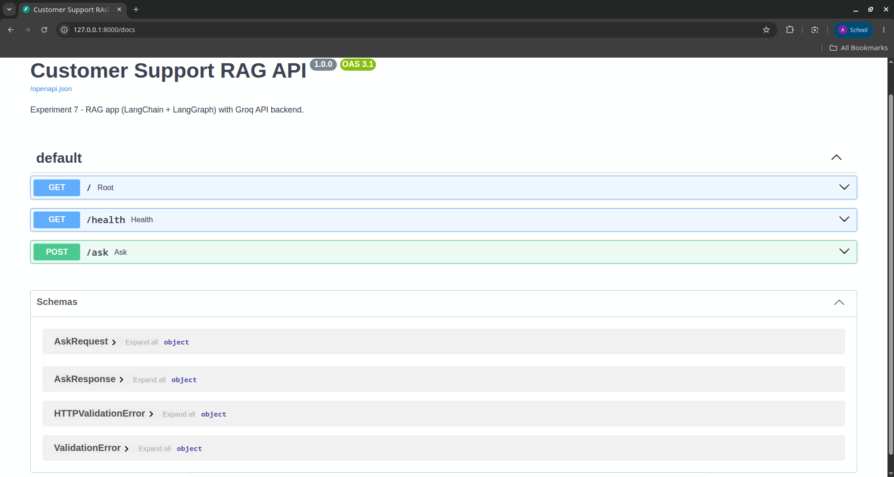 |
| Root endpoint | 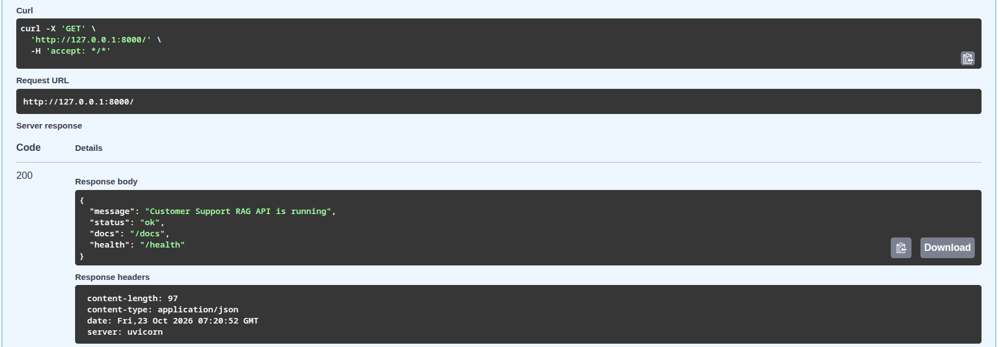 |
| Health endpoint | 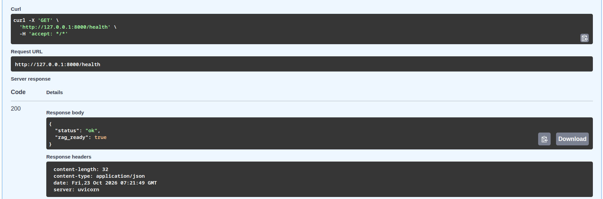 |
| Supported question | 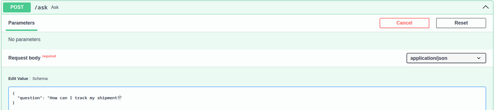 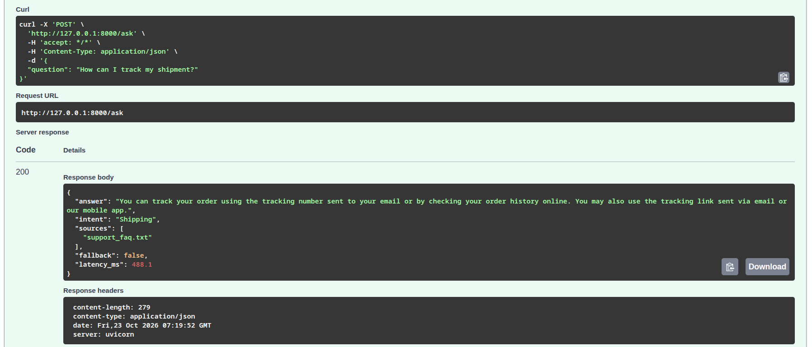|
| Unsupported question | 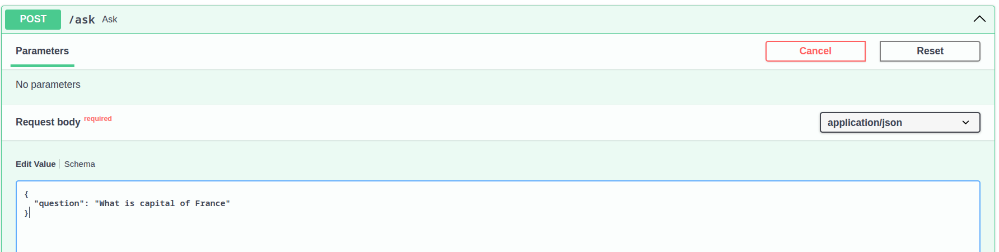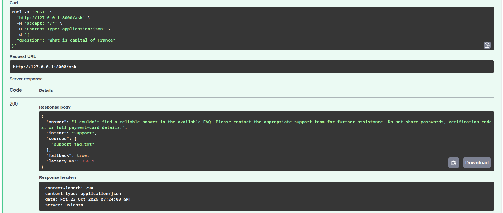 |
| Empty question | 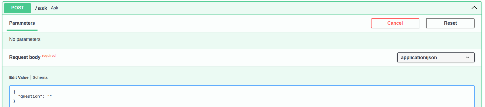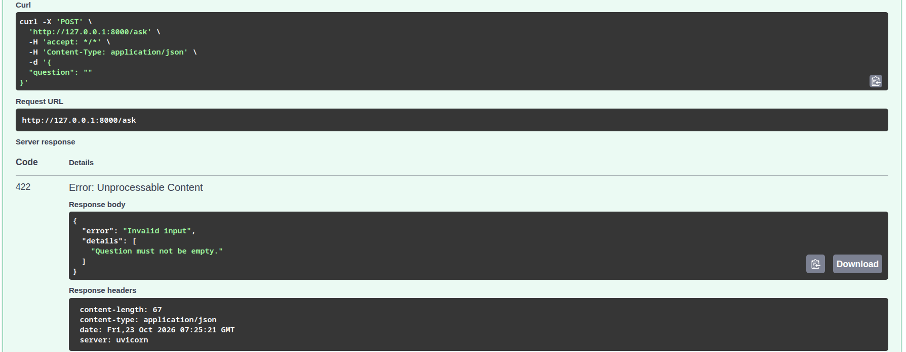 |
| Long question | 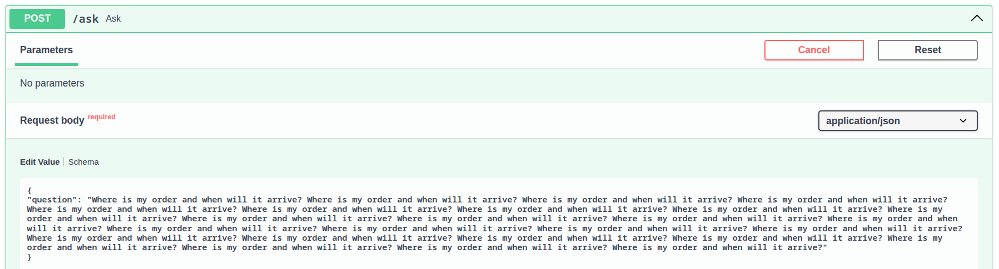 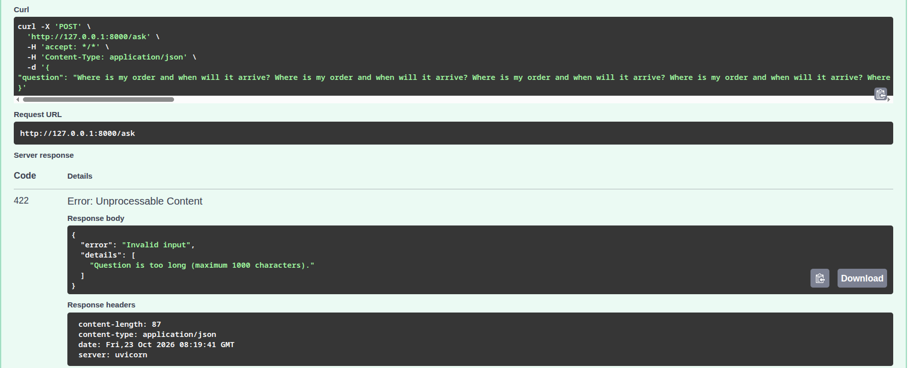 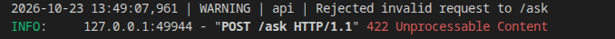|
| Backend unavailable | 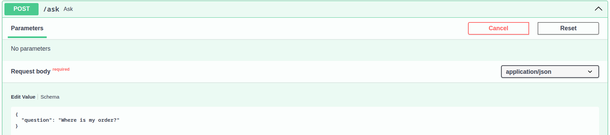 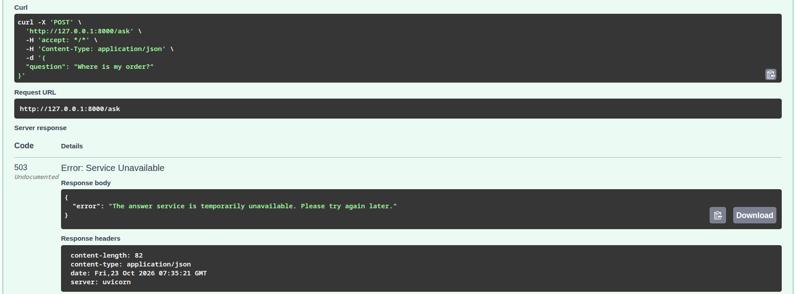 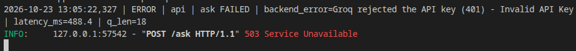|
| Response-time measurement | 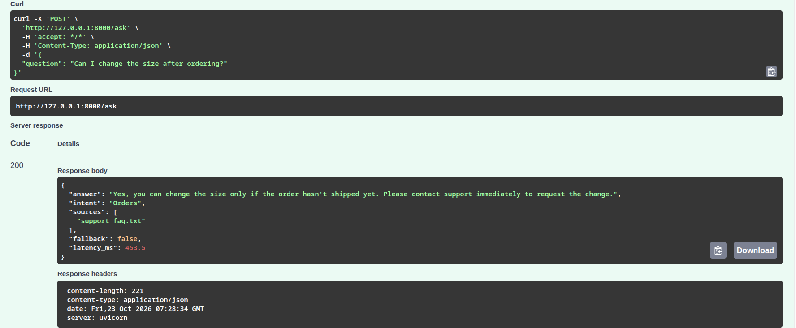 |
| Logs | 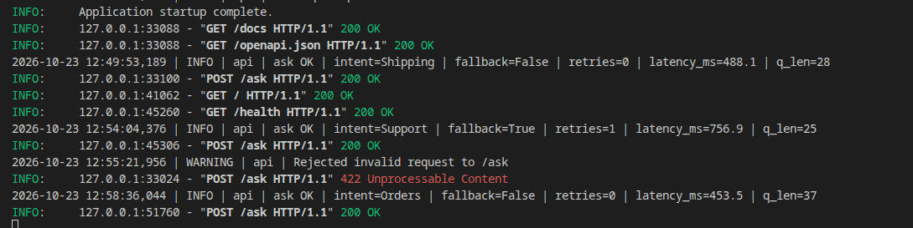 |

## 7. Testing checklist
- [ ] GET / returns API status and navigation links
- [ ] GET /health returns a successful status
- [ ] A valid question receives an answer
- [ ] An unsupported question triggers the fallback response
- [ ] An empty question is rejected
- [ ] A very long question is rejected
- [ ] A backend/network failure produces a controlled error
- [ ] Response time i.e latency is recorded
- [ ] No API key or secret appears in source control, logs, or screenshots

## 8. Result
The existing RAG application was exposed through a FastAPI endpoint and tested with input validation, error handling, basic logging, and response-time measurement.

Selected backend: ☑ Cloud-hosted API ☐ Ollama local LLM

## 9. How to Run the Experiment

**Step 1 – Get a free Groq API key**
1. Go to https://console.groq.com/keys and create an account.
2. Create an API key and copy it. Keep it private.

**Step 2 – Set up the project folder**
1. Ensure `support_faq.txt` is present in the project folder.
2. Copy `.env.example` to `.env`:
   ```bash
   cp .env.example .env
   ```
3. Open `.env` and configure:
   - `GROQ_API_KEY`: your Groq API key.
   - `GROQ_MODEL`: `qwen/qwen3.8-27b` (or `llama-3.3-70b-versatile` / `llama-3.1-8b-instant`).
   - `QDRANT_URL`: your Qdrant Cloud cluster URL (e.g. `https://...cloud.qdrant.io`).
   - `QDRANT_API_KEY`: your Qdrant API key.

**Step 3 – Install requirements** (Python 3.10 or later)
```bash
python -m venv .venv
source .venv/bin/activate        # Linux/Mac
.venv\Scripts\activate           # Windows
pip install -r requirements.txt
```

**Step 4 – Start the server**
```bash
uvicorn app:app --reload
```
Wait until the console shows "Startup complete". The first run uploads the chunks to your Qdrant collection; subsequent runs connect instantly to the existing collection.

## 10. Discussion Questions

**1. What is the purpose of FastAPI in this experiment?**

FastAPI converts the RAG pipeline into a web API that can be accessed by other applications. Other programs can send a question to the `/ask` endpoint and receive an answer. It also provides input validation and an interactive documentation page at `/docs` for testing the API endpoints.

**2. What is the difference between a local LLM and a cloud-hosted LLM API?**

A local LLM, such as Ollama, runs on our own computer and uses its CPU, RAM, and GPU resources. A cloud-hosted LLM API, such as Groq, runs on the provider's servers. Our application communicates with it over the internet using an API key. Cloud APIs may have usage quotas and rate limits.

**3. Does hosting FastAPI in the cloud automatically host the LLM there?**

No. Hosting FastAPI in the cloud only hosts our API application. The LLM runs separately, either on the cloud provider's servers, as in the case of Groq, or on a separate machine running a local model through Ollama.

**4. Why should an API key not be hard-coded in Python source code?**

Hard-coding an API key in Python source code can expose it when the code is shared or uploaded to platforms such as GitHub. Unauthorized users could misuse the key and consume the available quota. Therefore, the key should be stored securely in a `.env` file, which should be excluded from version control using `.gitignore`.

**5. What is input validation, and why is a maximum question length useful?**

Input validation involves checking user input before processing it. For example, the application should reject empty questions and inputs that do not meet the required format. A maximum question length prevents excessively large inputs from increasing processing time, consuming unnecessary tokens, and exhausting the API quota.

**6. What is the purpose and limitation of a health endpoint?**

The health endpoint provides a quick way to check whether the API service is running and whether essential components, such as the vector store, are loaded. However, it may not verify whether the external LLM API is accessible, the API key is valid, or the generated answers are accurate. Therefore, the application may report a healthy status while actual question-answering requests fail.

**7. Why should the model and vector index not be loaded for every request?**

Loading the embedding model and computing vectors for the entire dataset require significant CPU/GPU time and memory. Repeating these operations for every request would create huge response latencies and exhaust resources. In this production setup, the FAQ documents are embedded once into a persistent Qdrant Cloud collection (`support_faq`), and the connection is established once during application startup and reused for all subsequent search requests.

**8. What should RAG do when the answer is absent from its knowledge base?**

When the retrieved documents do not contain sufficient information to answer a question, the RAG system should avoid generating unsupported information. Instead, it should return a fallback message indicating that sufficient information is unavailable. In this application, the model returns `INSUFFICIENT_CONTEXT`, the retrieval process is retried once, and the fallback message is returned if sufficient context is still unavailable.

**9. Name two reasons a cloud inference request might fail.**

1. The API key may be invalid or expired, or the specified model name may be incorrect.
2. The request may exceed the available API quota or rate limit. Network failures and request timeouts are other possible causes.

**10. Is this lab application fully production-ready? Name two additional requirements for a real public service.**

No. Although the application provides an API interface, input validation, and error handling, additional measures are required before it can be deployed as a reliable public service.

Two important requirements are:

1. **Authentication:** Ensures that only authorized users or applications can access protected endpoints.
2. **Rate limiting:** Restricts the number of requests a user can make within a specified period to prevent abuse and excessive resource consumption.

## 11. Conclusion

In this experiment, the Customer Support RAG application from Experiment 6 was turned into a production-oriented API using FastAPI, with the Groq cloud API as the LLM backend and a managed Qdrant Cloud cluster for vector storage. We added input validation, error handling, logging, and response-time measurement. We tested the `/`, `/health`, and `/ask` endpoints with supported, unsupported, empty, and too-long questions, and with a backend failure. The app returned grounded answers, gave a fallback when the FAQ had no answer, and showed only generic errors without exposing API keys or secrets. By leveraging Qdrant Cloud, vectors are persisted remotely, eliminating redundant indexing upon restart. The experiment demonstrated the clear difference between a prototype and a production-oriented application.